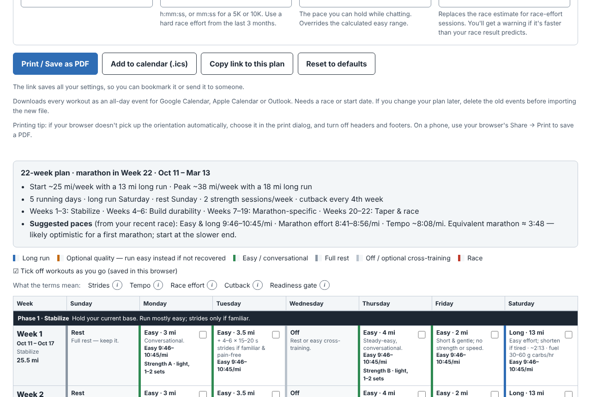
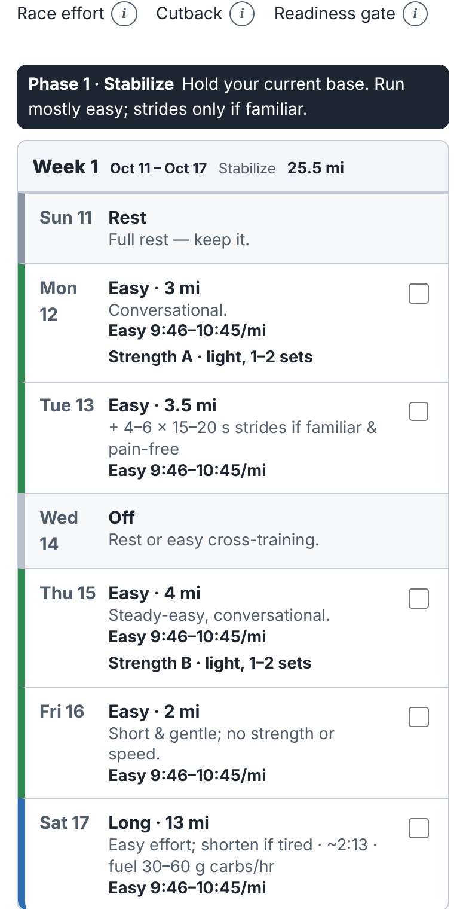

# Physical Training Planner

A free, printable training planner for the marathon and half marathon. Enter your current mileage and how you like to train, and it builds a week-by-week, readiness-based plan you can print, export to your calendar, and tick off as you go.

**Live site:** https://evansmith1377.github.io/physical-training-planner/

<p>
  
  
</p>

The page is a single `index.html` with no build step, no dependencies, and no network requests.

## Features

- **Three goals.**
  - *Marathon:* 2–3 week taper.
  - *Half marathon:* 1–2 week taper.
  - *Build durability:* a base of up to 35 mi/week and 16 mi long runs, with no race.
- **Readiness-based phases:** Stabilize, Build durability, Race-specific, and Taper. Each phase opens with the "readiness gate" to meet before moving on, and repeating a week is expected.
- **Quick-start presets.** Six starting points, from Sofa Starter (a gentle first half) to Mileage Monster (60+ mi weeks), plus Emily's Starting Point, the defaults. A preset sets the training fields only; your units, dates and paces stay, and Undo brings your settings back.
- **Your week, your way.**
  - 4, 5, or 6 running days.
  - Saturday or Sunday long run, and any rest day.
  - 0–2 strength sessions placed on easy days.
  - Cutbacks every 3rd or 4th week.
- **Optional race or start date.** Each week gets real dates, and a one-click "Use N weeks" fits the plan to your race.
  - With a race date, weeks end on race day. If the race isn't on your long-run day, race week moves the race to the right day.
- **Add to calendar.** Downloads an `.ics` file with every workout as an all-day event, for Google Calendar, Apple Calendar or Outlook. Re-importing the same plan doesn't create duplicates; if you change the plan, delete the old events first.
- **Checkmarks.** Tick off workouts on screen; they're saved in your browser and print as checkboxes (ticked ones print ticked). A tick belongs to its day and type of workout, so changing the plan never moves it onto a different workout.
- **US or metric units.** Switching converts the values you've already entered.
- **Optional pace guidance.** From a recent race, a known easy pace, or a goal race pace, the calendar shows easy, tempo, steady and race-effort paces next to the effort cues.
- **Print-ready.**
  - Landscape or portrait, US Letter or A4, with the calendar header repeated on every page.
  - An optional reference guide follows the calendar: effort, nutrition, strength exercises, hydration, safety and sources. It starts on a new page, and each topic (like the weekly self-check) stays on one page.
  - A phase's readiness gate prints on the same page as the first week of that phase.
- **Works everywhere.** Stacked week cards on phones, light and dark mode, keyboard and screen-reader friendly.
- **Shareable and private.** "Copy link to this plan" puts your plan settings in the page address; body weight is never included. Settings and checkmarks are stored only in your browser, and a Content Security Policy stops the page from contacting any server.

## How the plan is built

All distances are calculated in miles and converted for display.

| Rule | Value |
|---|---|
| Weekly distance inputs | Usual 12–99 mi (19–160 km); peak 20–99 mi (32–160 km) |
| Phase 1 (Stabilize) | 3 weeks at your current distance and long run (long run up to 55% of the week) |
| Weekly build | +8% per build week (min 1.5 mi, max 3 mi), up to your peak |
| Long run | +1 mi per build week at most and ≤ 50% of the week. Once at the peak, it alternates between the peak and about 85% of it. Capped at 20 mi (marathon), 14 mi (half), 16 mi (durability) |
| Cutback weeks | About 25% less distance and about 28% shorter long run, every 3rd or 4th week |
| Race-specific block | Marathon: up to 16 weeks including taper (warning below 14). Half: up to 12 (warning below 10) |
| Taper | Marathon, 3 weeks: 80% → 65% of peak → race week (2 weeks: 72% → race week). Half, 2 weeks: 75% → race week (1 week: race week only) |
| Quality | Strides in Phase 1 and cutbacks; progressive tempo in Phase 2; alternating tempo and race-effort sessions in Phase 3 |
| Minimum length | Marathon 10 weeks, half 8, durability 6 |

When inputs conflict, the page shows a warning instead of silently adjusting. Examples: a plan too short or too long, a rest day on the long-run day, a peak below your current mileage, weekday runs longer than the long run (high volume on few days), a taper that doesn't fit the goal, out-of-range values from a shared link, a race date that has passed, or a projected base that misses the readiness gate.

**Paces** use the Daniels/Gilbert race-equivalency equations: easy covers about 62–70% of aerobic capacity and tempo about 88%. The race-effort range is the predicted pace plus a buffer of 15 s/mi for the marathon or 6 s/mi for the half. These formulas tend to be optimistic for first marathons, and the page says so.

## Development

The site needs nothing to run. The tests use Python, pytest and Playwright (with axe-core for accessibility):

```sh
pip install -r requirements-dev.txt
python -m playwright install chromium
pytest -q
```

The suite serves the page over local HTTP, so the Content Security Policy applies, and fails on any console error. It covers layout from 320 to 1280 px, units, shared links (including hostile ones), each goal, dates and calendar export, checkmarks, print sizes, plan invariants across many settings, and serious accessibility violations.

| Script | Purpose |
|---|---|
| `python scripts/csp_hash.py` | Update the CSP hash after editing the inline `<script>` (`--check` is used in CI) |
| `python scripts/screenshots.py` | Regenerate `assets/og-image.png` and the README screenshots |

**CI and deploy:** every pull request runs the tests (`.github/workflows/ci.yml`). Each merge to `main` runs them again and deploys `index.html` and `assets/` to GitHub Pages (`.github/workflows/deploy.yml`). Actions are pinned to commit SHAs, and Dependabot proposes one grouped update PR per month for the actions and one for the test dependencies, skipping releases less than a week old. One-time setup: **Settings → Pages → Build and deployment → Source: GitHub Actions**.

**Branch protection:** `.github/rulesets/main.json` is a repository ruleset for `main`: changes land only through a squash-merged pull request with the `test` check passing on an up-to-date branch and all review threads resolved, and the branch can't be force-pushed or deleted. GitHub doesn't apply it automatically. Import it once under **Settings → Rules → Rulesets → New ruleset → Import a ruleset**.

To host the page elsewhere, copy `index.html` and the `assets/` folder to any static host. If the address changes, update the canonical and `og:` URLs in `index.html`.

See [CONTRIBUTING.md](CONTRIBUTING.md) to propose changes, and [CLAUDE.md](CLAUDE.md) for the code map and conventions.

## Browser support

Current versions of Chrome, Edge, Firefox, and Safari. The ⓘ info bubbles use the native Popover API, with a script fallback for older browsers.

## Disclaimer

General fitness guidance only. This is not medical advice, and it does not replace an individualized plan from a coach, clinician, or sports dietitian.

## License

Released into the public domain under [the Unlicense](LICENSE).
